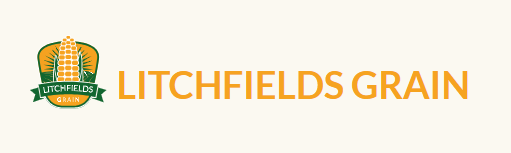
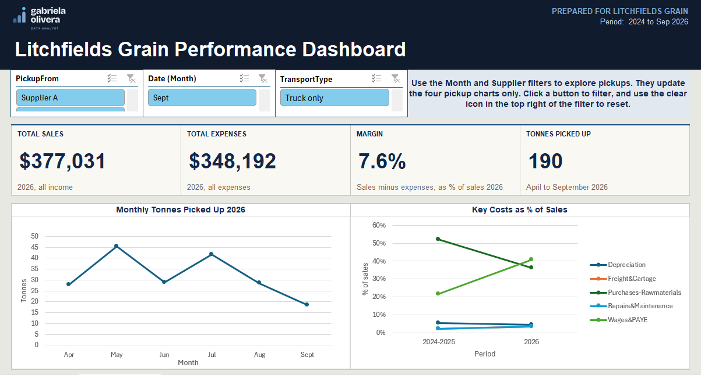
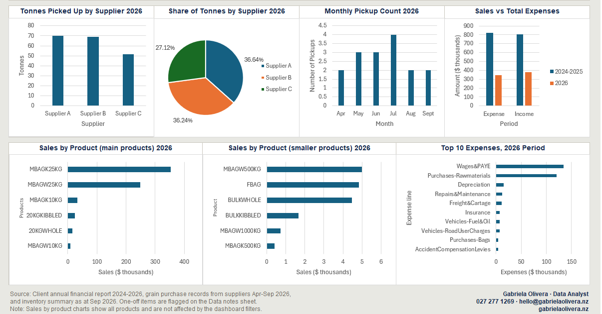

# Grain Case: data consolidation and reporting for a small grain business



A portfolio project for [**Litchfields Grain**](https://www.litchfieldsgrain.co.nz), a family-run New Zealand company based in Te Puke, Bay of Plenty, with more than 40 years of experience in maize. The business shared records from several sources, and the goal was to bring them together into one Excel workbook that shows sales, expenses, margin, grain pickups and pricing in a single, easy-to-use dashboard.

> **A note on confidentiality.** This project is shared with the client's permission. Any figures shown in the case study, and the names of suppliers and customers, have been changed for confidentiality. **No database, raw data or client files are shared in this repository.** What is shared is the working methodology: how the data was prepared, modelled and reported.

## What is in this repository

```
grain-case/
├── README.md
├── docs/
│   ├── Data_Consolidation_Methodology.md   How the data was consolidated, modelled and checked
│   ├── Data Consolidation Methodology (v0.9).pdf   The same methodology as a PDF
│   └── Appendix_Findings_and_Decisions.md  Every data-quality finding and cleaning decision
├── images/
│   ├── dashboard-1.png                     Dashboard, top half
│   ├── dashboard-2.png                     Dashboard, bottom half
│   ├── data-model-diagram-1.png            Tables and fields of the data model
│   └── data-model-diagram-2.png            Measures and date hierarchy
├── case-study/
│   └── Litchfields Grain - Case Study.pdf  One-page case study
└── assets/                                 Logos
```

## The approach in brief

1. **Sources.** An item list and an inventory report from the accounting system, the annual financial statements, and a handwritten record of grain pickups, which was typed into a table and checked against the original.
2. **Power Query.** Each source is read and cleaned in its own query, with a layered structure (staging, dimensions and facts) so every step can be traced.
3. **Data Model.** A star schema in Excel's Data Model, with a product table, a calendar table and fact tables for sales, income and expenses, and pickups.
4. **Reporting.** PivotTables and PivotCharts with slicers, nine charts and four headline KPIs, built on top of the model.
5. **Quality checks.** Totals are reconciled against the original reports, and every issue found is logged with its resolution in the methodology.

## Dashboard





## Data model


## Tools

Microsoft Excel, Power Query (M), Data Model / Power Pivot (DAX), PivotTables and PivotCharts.

## How AI was used

All analysis of the real data was done manually, and the client's data was never entered into any AI tool. AI was used only for generic technical support (for example formula syntax and best practice) and for drafting wording and templates, always with made-up sample data.

## Status

Methodology: version 0.9. The one-page case study is published with the client's approval, and the full write-up is on [gabrielaolivera.nz](https://gabrielaolivera.nz/case-studies/litchfields-grain/).

## Contact

<picture>
  <source media="(prefers-color-scheme: dark)" srcset="assets/gabriela-logo-dark.png">
  
</picture>

Gabriela Olivera, Data Analyst
[gabrielaolivera.nz](https://gabrielaolivera.nz) · hello@gabrielaolivera.nz
