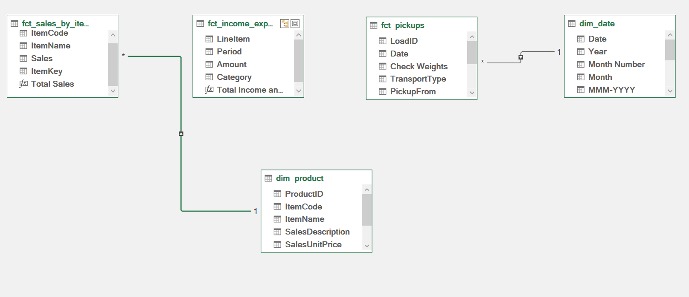
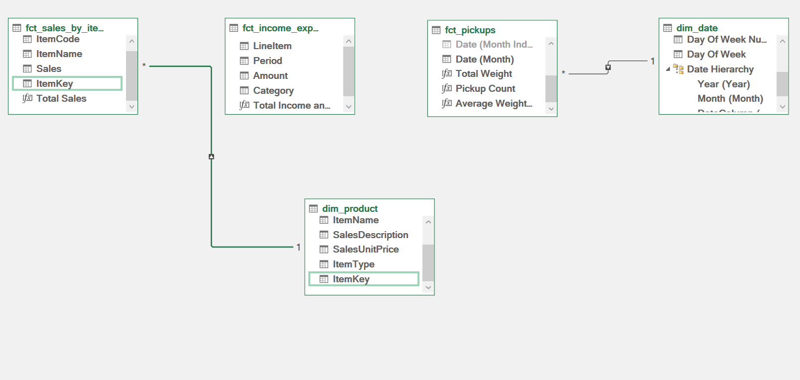

# Data Consolidation and Modelling Methodology

**Project:** Data source consolidation and analytical reporting for a small grain (maize) business
**Analyst:** Gabriela Olivera, Data Analyst · hello@gabrielaolivera.nz · 027 277 1269 · gabrielaolivera.nz
**Location:** Mount Maunganui, Bay of Plenty, New Zealand
**Engagement:** Pro bono, in exchange for a business reference
**Tools:** Microsoft Excel, Power Query (M), Data Model / Power Pivot (DAX), PivotTables
**Version:** 0.9 · **Date:** 08/10/2026

The full data dictionaries, findings log and decision log are in the [Appendix](Appendix_Findings_and_Decisions.md).

---

## 1. Purpose and scope

This document sets out the method used to consolidate several raw data sources (CSV, PDF, Excel and image) into one Excel workbook, build a relational data model and produce a PivotTable-based report.

The aim is a process that is **repeatable, auditable and transferable**: anyone with working Excel knowledge should be able to see where each figure comes from, what was changed, and how to refresh the report with new data.

**In scope:** data ingestion with Power Query, cleansing and validation, data model design, measures and PivotTable reporting, and documentation of findings, decisions and quality checks.

**Out of scope:** commercial, accounting or tax advice, and automation outside Excel (external databases, cloud services).

---

## 2. Confidentiality and use of tools

| Principle | How it applies |
|---|---|
| Client data | Kept only in the local working environment. Not shared with third parties or with AI tools. |
| Analysis | All analytical work on real data is done manually by the analyst. |
| Technical support | AI is used only for generic technical support (M and DAX syntax, best practice) and for drafting wording and templates, always with made-up sample data. |
| This document | Contains no client names, figures or files. Sources use generic codes (F01 to F05). |

---

## 3. Sources

| ID | Type | Generic description | Staging query | Status |
|---|---|---|---|---|
| F01 | CSV | Item (product) master list from the accounting system | `dim_product` | Loaded |
| F02 | PDF | Inventory items report (sales by item, no dates) | `fct_sales_by_item` | Loaded |
| F03 | PDF | Annual financial statements (income and expenses schedule, profit and loss) | `fct_income_expenses` | Loaded |
| F04 | Image | Purchases record: date, quantities, supplier and transport type | `fct_pickups` | Loaded (transcribed manually) |
| F05 | Export | Contacts list from the accounting system | n/a | Excluded (see D07) |

---

## 4. Process architecture

Each transformation has one logical home:

```
[Raw sources] → [Staging] → [Transformation] → [Data Model] → [Report]
 CSV/PDF/XLSX/IMG   stg_      int_ / dim_ / fct_   Relationships + DAX   PivotTables
```

| Layer | Purpose | Load setting |
|---|---|---|
| Parameters (`prm_`) | Folder paths and configurable values, so no path is hard-coded in a query. | Connection only |
| Staging (`stg_`) | One query per source: read, promote headers, set basic types. No business logic. | Connection only |
| Intermediate (`int_`) | Merges, appends and business rules. | Connection only |
| Dimensions (`dim_`) and facts (`fct_`) | Descriptive tables and transactional tables. | Data Model |
| Functions (`fn_`) | Reusable logic, such as standard text cleansing. | n/a |

**Naming:** queries use a layer prefix and a `snake_case` name; columns have descriptive names with the unit where relevant; Power Query steps are renamed to say what they do; DAX measures have readable names.

---

## 5. Ingestion and cleansing standards

**By source type**

- **CSV:** check delimiter, encoding and locale; confirm decimal separator and date format before setting types.
- **PDF:** check whether the connector finds tables or only pages; review tables split across pages; reconcile extracted totals with the totals printed on the document.
- **Excel:** connect to named tables rather than sheets; watch for merged cells, title rows and embedded subtotals.
- **Image:** Power Query cannot read images. The values are transcribed into an Excel table and checked cell by cell against the image, then ingested as an Excel source.

**Cleansing standards**

| Area | Standard |
|---|---|
| Data types | Set explicitly in staging, with a check for errors after each change. |
| Locale | Use "Change Type > Using Locale" when dates or decimals arrive in a different format. |
| Text | `Trim`, `Clean` and consistent capitalisation on keys and categories. |
| Units and currency | One unit per measure and one reporting currency (NZD), with GST treatment stated. |
| Nulls, blanks, duplicates | An explicit rule per column. Define the unique key before removing duplicates. |
| Keys | Standardise codes across sources, with a mapping where names differ. |

---

## 6. Data model

**Approach:** star schema. Fact tables hold keys and numbers; dimension tables describe them, with one unique key per row. Relationships are one-to-many with a single filter direction (dimension to fact), and a continuous `dim_date` calendar table is marked as the date table.





| Table | Type | Related to | Cardinality |
|---|---|---|---|
| `dim_product` | Dimension | `fct_sales_by_item` (on `ItemKey`) | One to many |
| `fct_sales_by_item` | Fact (one row per item, no date) | `dim_product` | Many to one |
| `fct_income_expenses` | Fact (one row per line item and period) | None. Periods are handled through the `Period` column (see D14) | n/a |
| `fct_pickups` | Fact (one row per load) | `dim_date` (on `Date`) | Many to one |

Two design points are worth knowing. Sources are related only through keys that exist in the data, never by guessing (see D03), and item codes are standardised into an `ItemKey` (spaces removed, upper case) because each source writes them differently (see H18). Column-level definitions and query steps are in Appendix A.

---

## 7. Quality checks

| Check | Result |
|---|---|
| Row counts: rows in each source vs rows loaded | Passed for all four loaded sources |
| Control totals: sums vs the totals in the original source | Passed for F02 and F03. For F04 the written total differs slightly from the entries (see H06); entries kept as recorded |
| Orphan keys: facts with no match in their dimension | Passed (sales by item through `ItemKey`, pickups by date) |
| Dimension duplicates: key uniqueness | Passed (`ItemCode` unique across all rows) |
| Type errors: zero errors in typed columns after refresh | Passed |
| Full refresh: "Refresh All" completes without errors | Passed |

---

## 8. Reporting

PivotTables are built on the Data Model, not on worksheet ranges, with explicit DAX measures and slicers connected to the dimension tables. Every metric is defined:

| Metric | Definition | How it is calculated |
|---|---|---|
| Total sales (by period) | Income for the selected period | `Total Income and Expenses := SUM([Amount])`, with `Category` = Income and `Period` filtered |
| Total expenses | Expenses for the selected period | The same measure, with `Category` = Expense |
| Margin | Share of sales left after expenses | (Total sales − Total expenses) ÷ Total sales |
| Expenses as % of sales | How much of each dollar of sales is spent | Total expenses ÷ Total sales |
| Total sales (by product) | Sales per item over the whole report period | `Total Sales := SUM([Sales])` |
| Tonnes picked | Total weight collected | `Total Weight := SUM([Check Weights])` |
| Average weight per pickup | Average weight of one pickup | `Average Weight per Pickup := AVERAGE([Check Weights])` |
| Pickup count | Number of pickups in the period | `Pickup Count := COUNTA([LoadID])` |

---

## 9. Main findings and decisions

The full logs (18 findings, 17 decisions) are in Appendix B and C. These are the ones that shaped the work most.

| Ref | What happened | How it was handled |
|---|---|---|
| H03 | The purchases record does not identify the product | Sources linked only by date and supplier. No product-level analysis is made from it. Recommended to the business: record the type of grain on each pickup |
| H13 | The purchases record is an image, and automatic reading returned many low-confidence cells | Transcribed manually and checked against the image (D12) |
| H15 | The inventory report has period totals only, with no dates | Sales by product are labelled as covering the whole report period. Sales for a period come from the income lines (D14) |
| H16 | Start-up and investment costs are mixed with operating expenses | Period comparisons carry a note. Recommended to the business: a separate category |
| H18 | Item codes differ in spacing and capitalisation between sources | `ItemKey` built in both tables and used for the relationship (D17) |

| Ref | Decision | Why |
|---|---|---|
| D02 | Star schema in the Data Model | Avoids duplication and keeps DAX measures simple |
| D03 | Do not infer missing products | Inferred values cannot be defended or audited |
| D09 | Load only the income and expenses schedule from the annual report | The other tables do not link to products, dates or suppliers, and some hold sensitive details |
| D14 | Period sales from the income lines; product sales from the inventory report | The inventory report has no dates |
| D17 | Relate products on a standardised `ItemKey`, keeping `ItemCode` unchanged | Original codes stay available, and the key is rebuilt the same way on each refresh |

---

## 10. Glossary

| Term | Definition |
|---|---|
| Power Query | Excel's tool for connecting to, transforming and combining data (M language). |
| DAX | Formula language of the Data Model, used for measures. |
| Fact table | A table of measurable events or transactions (sales, purchases). |
| Dimension table | A descriptive table that gives context to facts (product, date). |
| Star schema | A central fact table linked to several dimension tables. |
